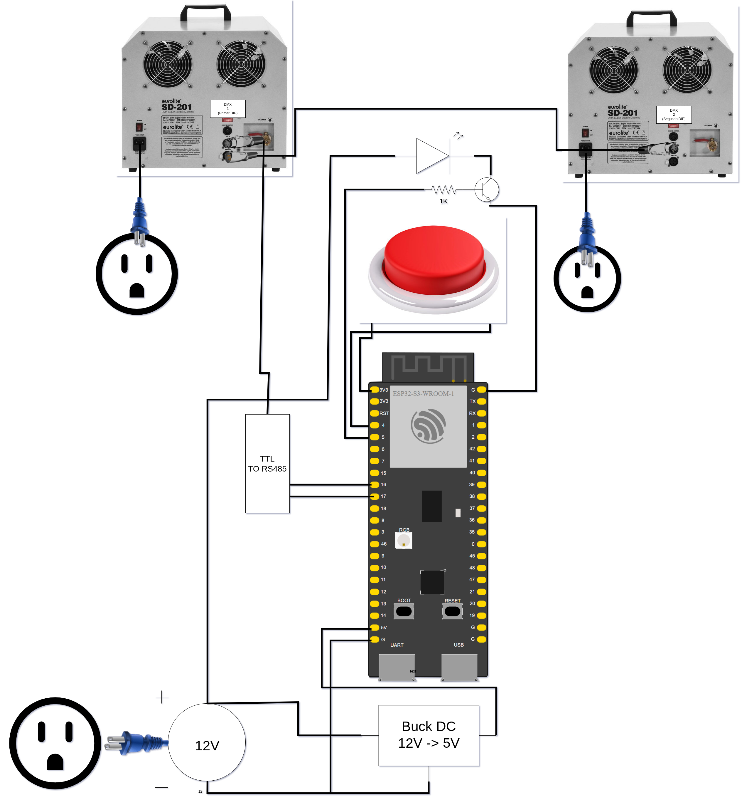

# Firmware ESP32 Sala Pompas | Cat in the Hat
Este repositorio contiene el firmware para el microcontrolador encargado del sistema de control de las máquinas de pompas de la promo de Cat in the Hat.

## Estructura del código
El programa controla dos máquinas Eurolite SD-201 por DMX desde un ESP32-S3, activándolas mediante un final de carrera. 

Al principio se definen los pines (el final de carrera en el GPIO 4, el LED indicador en el GPIO 5 y la transmisión DMX por el UART 2 en los GPIO 16 y 15), la velocidad que se enviará a las máquinas y un array de 33 bytes que representa la trama DMX, donde la posición 0 es el código de inicio y cada posición siguiente corresponde a una dirección.

En `setup()` se configuran el pin del final de carrera con resistencia pull-down, el pin del LED como salida apagada, se inicializa la trama a cero y se arranca el UART a 250000 baudios con formato 8N2, que es el que exige el protocolo DMX. La función `sendDMXPacket()` envía una trama completa: primero genera el BREAK invirtiendo la línea de transmisión durante 120 µs, después el MARK AFTER BREAK de 12 µs, y finalmente transmite los 33 bytes de datos.

Por último, `loop()` lee el estado del final de carrera cada 25 ms; cuando el pin está en HIGH, asigna la velocidad máxima a las direcciones 1 y 2 y enciende el LED a través del transistor, y en caso contrario pone ambas direcciones a cero y apaga el LED, enviando la trama actualizada en cada ciclo para que las máquinas reciban la señal de forma continua.

## Conexiones
Se incluye el siguiente diagrama de conexiones:

